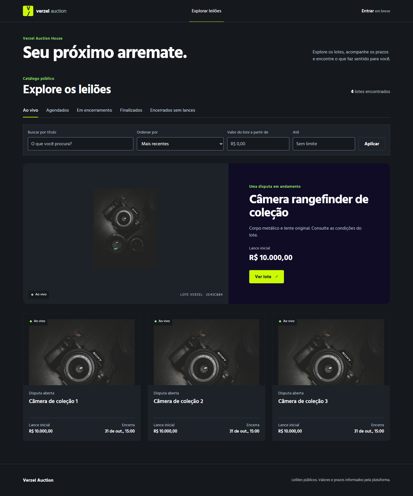
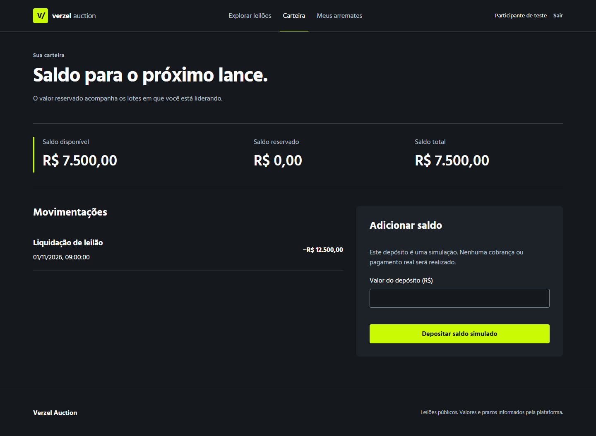
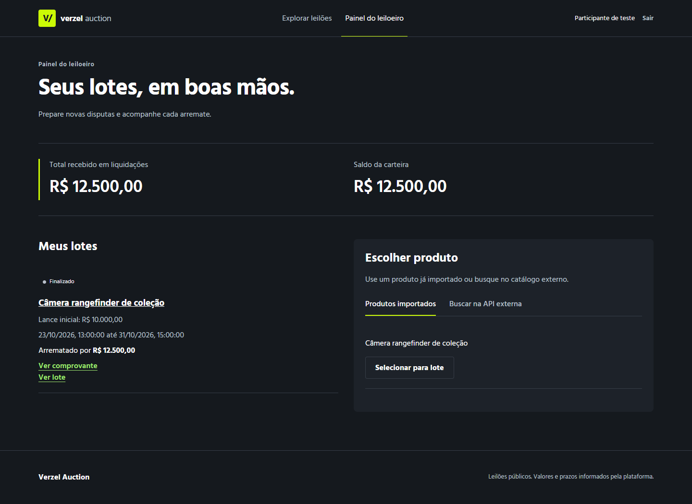
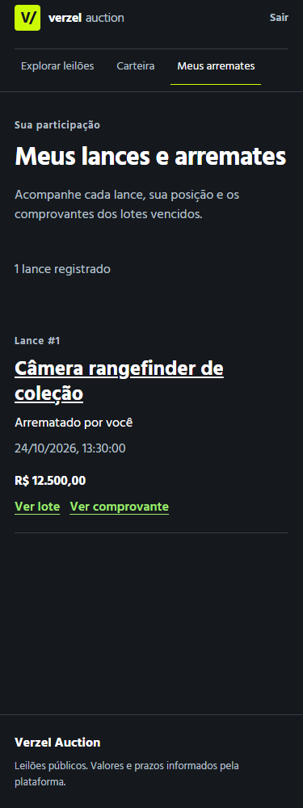

# Verzel Auction House

Frontend de uma plataforma de leilões: explore lotes, participe de disputas, acompanhe sua carteira e consulte comprovantes e auditoria pública.

Construído com **React 19, TypeScript e Vite**, com interface responsiva, tema escuro e integração REST e Socket.IO.

## Preview

### Vitrine de leilões

Catálogo público com busca, filtros por situação e valores, ordenação e destaque de lote.



### Carteira e painel do leiloeiro

| Carteira                                                                                         | Painel do leiloeiro                                                                                        |
| ------------------------------------------------------------------------------------------------ | ---------------------------------------------------------------------------------------------------------- |
|  |  |

### Também no celular



As capturas foram feitas no navegador com dados de demonstração e respostas de API simuladas. A vitrine registra uma etapa anterior da interface; as demais capturas vêm da suíte visual de conta. Não representam uma validação contra o backend real.

## Funcionalidades implementadas

- **Exploração:** vitrine, filtros, paginação, detalhe do lote, histórico de lances e contagem regressiva.
- **Participação:** login, acesso por papel, envio de lances e acompanhamento de posição e arremates.
- **Carteira:** saldo disponível, reservado e total, extrato e depósito simulado com chave de idempotência.
- **Leiloeiro:** seleção e importação de produtos, formulário de leilão e acompanhamento de lotes e liquidações.
- **Transparência:** auditoria pública e comprovante de arremate.
- **Atualização:** eventos Socket.IO invalidam consultas; atualização periódica mantém os dados sincronizados quando a conexão ao vivo falha.

## Executar localmente

Requer **Node.js 22.12 ou superior** e npm.

```powershell
npm ci
Copy-Item .env.example .env.local
npm run dev
```

Abra a URL informada pelo Vite, normalmente `http://localhost:5173`.

Configure o endereço do backend em `.env.local`:

```dotenv
VITE_API_BASE_URL=http://localhost:3000
```

Para usar os fluxos reais, o backend precisa estar disponível nesse endereço e permitir a origem do frontend via CORS. A aplicação usa o contrato versionado em [`contracts/openapi.json`](contracts/openapi.json); não há um modo de demonstração embutido ao executar `npm run dev`.

Variáveis `VITE_*` são públicas no navegador. A sessão fica apenas em memória: recarregar a página exige novo login. Cadastro e renovação de token não fazem parte do fluxo atual.

## Stack

| Área        | Tecnologias                                              |
| ----------- | -------------------------------------------------------- |
| Interface   | React 19, React Router, CSS e Hind Madurai               |
| Dados e API | TanStack Query, openapi-fetch e tipos gerados do OpenAPI |
| Formulários | React Hook Form e Zod                                    |
| Tempo real  | Socket.IO Client                                         |
| Qualidade   | TypeScript strict, ESLint e Prettier                     |
| Testes      | Vitest, Testing Library e Playwright                     |

## Comandos

| Comando                      | Uso                                                    |
| ---------------------------- | ------------------------------------------------------ |
| `npm run dev`                | Iniciar o servidor de desenvolvimento                  |
| `npm run build`              | Validar tipos e gerar o build em `dist/`               |
| `npm run preview`            | Servir o build localmente                              |
| `npm run lint`               | Conferir ESLint e formatação                           |
| `npm run typecheck`          | Validar TypeScript                                     |
| `npm run test`               | Executar testes unitários e de componentes             |
| `npm run test:e2e`           | Executar jornadas e verificações visuais no Playwright |
| `npm run format`             | Aplicar Prettier                                       |
| `npm run generate:api-types` | Regenerar tipos a partir de `contracts/openapi.json`   |

O Playwright está configurado para **Microsoft Edge** e inicia o Vite automaticamente na porta 5173. Instale o Edge ou ajuste o `channel` em [`playwright.config.ts`](playwright.config.ts) para um navegador disponível. Os testes E2E usam respostas de API simuladas.

## Organização

```text
src/
  api/                 # Cliente HTTP e tipos gerados
  app/                 # Providers e rotas
  components/          # Layout e elementos compartilhados
  features/
    account/           # Meus lances e arremates
    auctions/          # Vitrine, sala e tempo real
    audit/             # Auditoria e comprovantes
    auth/              # Login, sessão e acesso por papel
    seller/            # Produtos e gestão de leilões
    wallet/            # Saldos, extrato e depósitos
  hooks/               # Comportamentos compartilhados
  styles/              # Tokens e estilos da interface
  test/                # Setup e testes da aplicação
contracts/             # Contrato e mapas de integração
e2e/                   # Jornadas e fixtures Playwright
docs/                  # Planos, checkpoints e capturas
```

O alias `@/` aponta para `src/`.

## Documentação

- [Requisitos do desafio](requirements.pdf)
- [Direção visual e tokens](DESIGN.md)
- [Mapa da API](contracts/API_MAP.md) e [eventos de tempo real](contracts/REALTIME_MAP.md)
- [Questões em aberto da integração](contracts/OPEN_QUESTIONS.md)
- [Checkpoints de implementação e limites da validação](docs/implementation-checkpoints.md)
- [Workflow de design](docs/design-workflow.md)

A validação ponta a ponta com backend real e o deploy permanecem pendentes, conforme os checkpoints de implementação.
