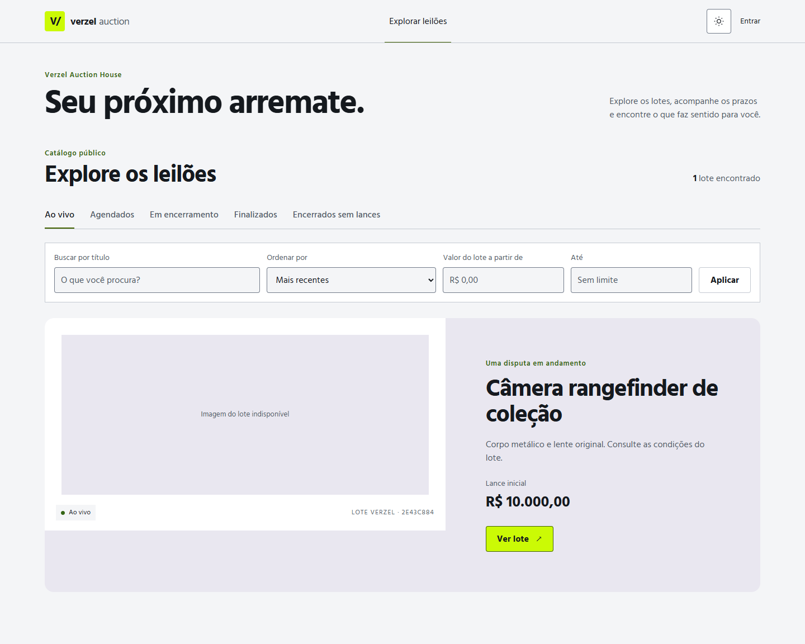
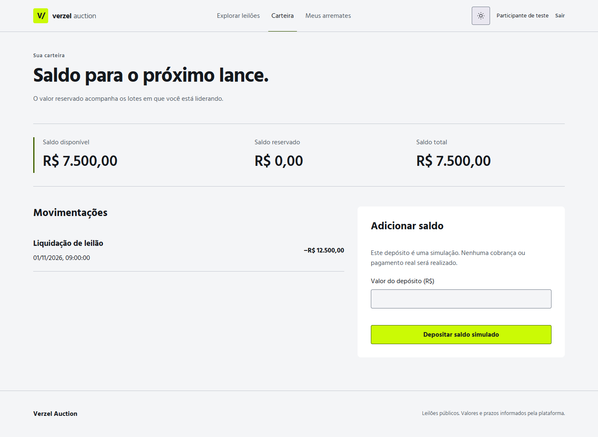
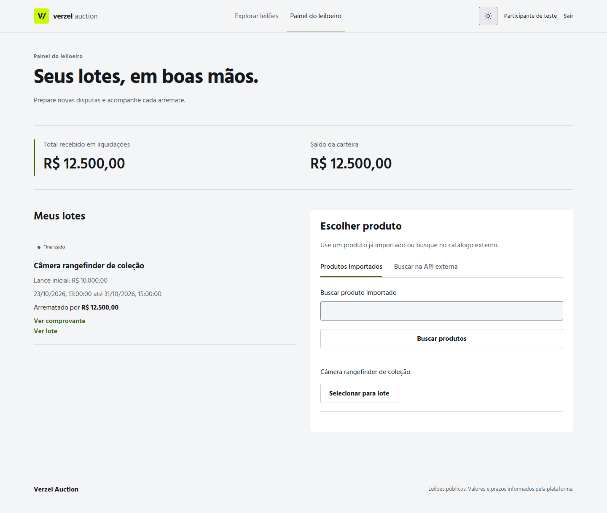
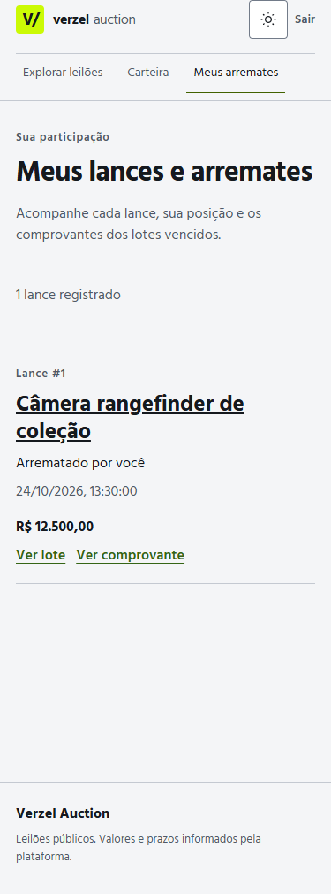

# Verzel Auction House

Frontend de uma plataforma de leilões: explore lotes, participe de disputas, acompanhe sua carteira e consulte comprovantes e auditoria pública.

Construído com **React 19, TypeScript e Vite**, com interface responsiva, temas claro e escuro e integração REST e Socket.IO.

Para avaliar o desafio, consulte o [guia unificado do recrutador no backend](https://github.com/self1027/tt-verzel-backend/blob/main/docs/guia-recrutador.md).
Ele reúne requisitos do PDF, roteiro manual, comandos e resultados da validação.
Os repositórios são independentes e podem ficar em quaisquer diretórios; a integração
usa o endereço configurado da API.

## Preview

### Vitrine de leilões

Catálogo público com busca, filtros por situação e valores, ordenação e destaque de lote.

| Tema escuro                                                                | Tema claro                                                                      |
| -------------------------------------------------------------------------- | ------------------------------------------------------------------------------- |
|  |  |

### Carteira e painel do leiloeiro

| Carteira                                                                                         | Painel do leiloeiro                                                                                        |
| ------------------------------------------------------------------------------------------------ | ---------------------------------------------------------------------------------------------------------- |
|  |  |
|                            |                          |

### Também no celular




As capturas mostram a interface atual nos dois temas, obtidas com Playwright e respostas de API simuladas. Não representam uma validação contra o backend real.

## Funcionalidades implementadas

- **Aparência:** alternância acessível entre claro e escuro, preferência persistida e fallback para o tema do sistema, com respeito a movimento reduzido.
- **Exploração:** vitrine, filtros, paginação, detalhe do lote, histórico de lances e contagem regressiva.
- **Participação:** login, acesso por papel, envio de lances e acompanhamento de posição e arremates.
- **Carteira:** saldo disponível, reservado e total, extrato e depósito simulado com chave de idempotência.
- **Leiloeiro:** seleção e importação de produtos, formulário de leilão e acompanhamento de lotes e liquidações.
- **Transparência:** auditoria pública e comprovante de arremate.
- **Atualização:** eventos Socket.IO invalidam consultas; atualização periódica mantém os dados sincronizados quando a conexão ao vivo falha.

## Executar localmente

Requer **Node.js 22.12 ou superior** e npm.

```powershell
npm ci
Copy-Item .env.example .env.local
npm run dev
```

Abra a URL informada pelo Vite, normalmente `http://localhost:5173`.

Configure o endereço do backend em `.env.local`:

```dotenv
VITE_API_BASE_URL=http://localhost:3000
```

Para usar os fluxos reais, o backend precisa estar disponível nesse endereço e permitir a origem do frontend via CORS. A aplicação usa o contrato versionado em [`contracts/openapi.json`](contracts/openapi.json); não há um modo de demonstração embutido ao executar `npm run dev`.

Variáveis `VITE_*` são públicas no navegador. A sessão fica apenas em memória: recarregar a página exige novo login. Cadastro e renovação de token não fazem parte do fluxo atual.

## Stack

| Área        | Tecnologias                                              |
| ----------- | -------------------------------------------------------- |
| Interface   | React 19, React Router, CSS e Hind Madurai               |
| Dados e API | TanStack Query, openapi-fetch e tipos gerados do OpenAPI |
| Formulários | React Hook Form e Zod                                    |
| Tempo real  | Socket.IO Client                                         |
| Qualidade   | TypeScript strict, ESLint e Prettier                     |
| Testes      | Vitest, Testing Library e Playwright                     |

## Comandos

| Comando                      | Uso                                                    |
| ---------------------------- | ------------------------------------------------------ |
| `npm run dev`                | Iniciar o servidor de desenvolvimento                  |
| `npm run build`              | Validar tipos e gerar o build em `dist/`               |
| `npm run preview`            | Servir o build localmente                              |
| `npm run lint`               | Conferir ESLint e formatação                           |
| `npm run typecheck`          | Validar TypeScript                                     |
| `npm run test`               | Executar testes unitários e de componentes             |
| `npm run test:e2e`           | Executar jornadas e verificações visuais no Playwright |
| `npm run format`             | Aplicar Prettier                                       |
| `npm run generate:api-types` | Regenerar tipos a partir de `contracts/openapi.json`   |

O Playwright padrão está configurado para **Microsoft Edge** e inicia o Vite automaticamente na porta 5173. Instale o Edge ou ajuste o `channel` em [`playwright.config.ts`](playwright.config.ts) para um navegador disponível. Os testes de `test:e2e` usam respostas de API simuladas.

### Avaliação com API real

Com frontend e backend já em execução em `localhost:5173` e `localhost:3000`:

```sh
npm run test:recruiter:mcp
npm run test:recruiter
npm run test:recruiter:report
```

O primeiro comando usa o **Playwright MCP da Microsoft** para percorrer páginas públicas,
gravar snapshots e conferir a largura mobile. O segundo executa filtros/temas,
busca/importação e gestão pela interface e uma disputa entre dois licitantes até
a liquidação. Esses testes usam a API real; o fluxo completo leva cerca de três minutos.

A jornada cria lotes próprios e deposita R$ 10,00 simulados em cada licitante,
com arremate de R$ 1,10; preserva os registros para consulta. Exige seed, witness
operacional e acesso do backend ao DummyJSON para importar um produto novo.
As senhas padrão são as do README do backend; use as variáveis `SEED_*` no
terminal se foram personalizadas. A sessão fica em memória; recarregar exige login.

`RECRUITER_FRONTEND_URL` e `RECRUITER_API_URL` alteram os endereços dos testes;
`VITE_API_BASE_URL` deve apontar à mesma API. Para outro navegador, configure
`PLAYWRIGHT_CHANNEL` e, se necessário, `PLAYWRIGHT_EXECUTABLE_PATH`.
Os artefatos ficam em `test-results/recruiter-mcp/` e `playwright-report/recruiter/`,
ignorados pelo Git; traces com credenciais são desativados na jornada real.

## Organização

```text
src/
  api/                 # Cliente HTTP e tipos gerados
  app/                 # Providers e rotas
  components/          # Layout e elementos compartilhados
  features/
    account/           # Meus lances e arremates
    auctions/          # Vitrine, sala e tempo real
    audit/             # Auditoria e comprovantes
    auth/              # Login, sessão e acesso por papel
    seller/            # Produtos e gestão de leilões
    wallet/            # Saldos, extrato e depósitos
  hooks/               # Comportamentos compartilhados
  styles/              # Tokens e estilos da interface
  test/                # Setup e testes da aplicação
contracts/             # Contrato e mapas de integração
e2e/                   # Jornadas e fixtures Playwright
docs/                  # Planos, checkpoints e capturas
```

O alias `@/` aponta para `src/`.

## Documentação

- [Requisitos do desafio](requirements.pdf)
- [Direção visual e tokens](DESIGN.md)
- [Mapa da API](contracts/API_MAP.md) e [eventos de tempo real](contracts/REALTIME_MAP.md)
- [Questões em aberto da integração](contracts/OPEN_QUESTIONS.md)
- [Checkpoints de implementação e limites da validação](docs/implementation-checkpoints.md)
- [Workflow de design](docs/design-workflow.md)

A validação local com backend real está disponível nos comandos `test:recruiter*`
e documentada no guia do recrutador. O deploy público continua sem validação nesta curadoria.
